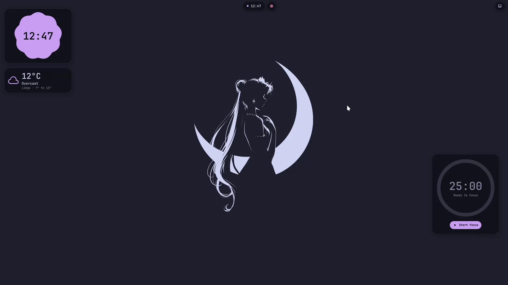

# mochi-wallpaper-selector

A [Mochi](https://github.com/Davidutz19/mochi) plugin to pick a wallpaper on the
island: a strip of your wallpapers with the selected one big in the middle.



[The same in full quality, as a video](docs/preview.mp4)

It sets the wallpaper with the daemon that runs (awww, swww, hyprpaper or swaybg)
or a command of your own, remembers the last one, and sets it again when Mochi
starts.

## Install

It needs Mochi 0.4.1 or newer, and a wallpaper daemon, or a command that sets one.

From Bento, Mochi's registry:

```sh
mochi bento add wallpaper-selector
```

Or from this repository, in `~/.config/mochi/plugins.toml`, then
`mochi plugins install wallpaper-selector`:

```toml
[plugins.wallpaper-selector]
source = "git-release:github.com/Davidutz19/mochi-wallpaper-selector"
```

`git-release:` downloads a release's static binary, so there is nothing to build;
`git:` builds it from source with cargo, or with Nix when cargo isn't there.

### With Nix

With home-manager's Mochi module, Nix builds it during the switch:

```nix
# flake.nix
inputs.mochi-wallpaper-selector = {
  url = "github:Davidutz19/mochi-wallpaper-selector";
  flake = false;
};

# home-manager
programs.mochi = {
  plugins.wallpaper-selector.src = inputs.mochi-wallpaper-selector;
  settings.modules = [ "wallpaper-selector" ];
  settings.module.wallpaper-selector.daemon = "awww";
};
```

The repository is a flake too: `nix build github:Davidutz19/mochi-wallpaper-selector`
builds the plugin, and its `packages.<system>.default` goes in
`programs.mochi.plugins.wallpaper-selector.package`.

### Then

Add `"wallpaper-selector"` to `modules` in `config.toml`, unless Bento or
home-manager did, and bind a key to open the picker:

```sh
mochi ipc wallpaper-selector toggle
```

```lua
-- Hyprland
hl.bind("SUPER + CTRL + W", hl.dsp.exec_cmd("mochi ipc wallpaper-selector toggle"))
```

## Keys

| Key | Does |
|---|---|
| Left, Right, H, L | Select the previous or next wallpaper |
| Home, End | Jump to the first or last |
| Enter | Set the selected wallpaper and close |
| R | Set a random one |
| Escape | Close |

With the mouse: a click selects a wallpaper, a click on the selected one sets it,
the wheel moves along.

## Settings

In the `[module.wallpaper-selector]` section of `config.toml`, or on the plugin's
page in Mochi's settings. `settings.toml` lists them, commented at their defaults:

| Setting | Default | |
|---|---|---|
| `directory` | `"~/Pictures/Wallpapers"` | The folder of wallpapers |
| `recursive` | `false` | Its subfolders too |
| `daemon` | `"auto"` | `auto`, `awww`, `swww`, `hyprpaper`, `swaybg` or `command`. `auto` takes the first of these that runs |
| `command` | `""` | With `daemon = "command"`: a shell command, `{path}` is the image, quoted. For example `"feh --bg-fill {path}"` |
| `transition` | `""` | awww and swww's transition, like `grow`, `fade` or `wipe` |
| `restore` | `true` | Set the last wallpaper again when Mochi starts |
| `default` | `""` | The wallpaper to set when none was picked yet: a path or a file name in the directory |

The last wallpaper is saved in `$XDG_STATE_HOME/mochi-wallpaper-selector/current`
(`~/.local/state/mochi-wallpaper-selector/current`).

## Actions

`mochi ipc wallpaper-selector <action>`, for keys and scripts:

| Action | Does |
|---|---|
| `toggle`, `open`, `close` | The picker |
| `set <path>` | Set a wallpaper: a path, or a file name in the directory |
| `next`, `previous`, `random` | Set another wallpaper from the directory |
| `restore` | Set the last wallpaper again, or the default |
| `current`, `list` | Print the wallpaper set last, or all of them |

## Development

```sh
nix develop          # or have cargo and rustc
cargo test
cargo clippy --all-targets -- -D warnings
```

To try changes, list the plugin with a `path:` source in `plugins.toml` and run
`mochi plugins install wallpaper-selector`. `mochi reload` restarts the backend
after a rebuild; QML changes to an installed copy need `systemctl --user restart mochid`.

Pushing a tag like `v0.2.0` builds static binaries for x86_64 and aarch64 and
attaches them to the release (`.github/workflows/release.yml`).

## License

MIT
